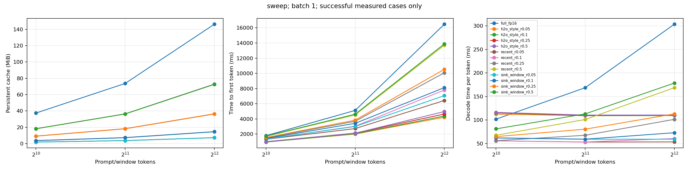
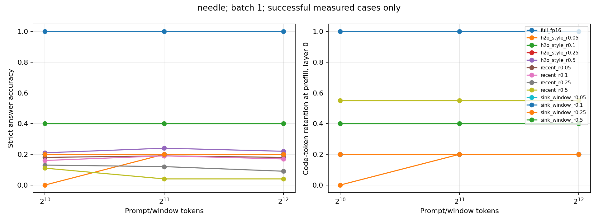
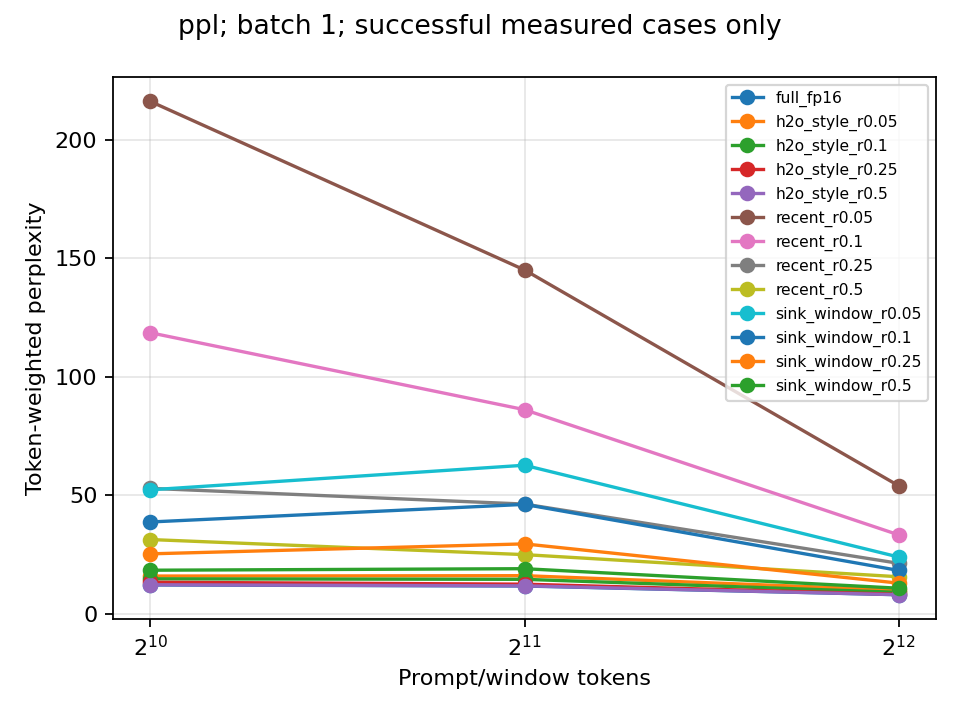

# GPU KV-cache eviction results

Model: `Qwen/Qwen2.5-3B-Instruct`. Revision: `aa8e72537993ba99e69dfaafa59ed015b17504d1`.
Family: `qwen2`. Dtype: `torch.float16`.
GPU: NVIDIA GeForce GTX 1080 Ti. Mode: `chunked_prefill_matched`.

All methods use identical chunked prefill. This full-precision reference is separate from the original monolithic baseline.
H2O-style uses explicit attention scoring and prunes after each chunk. Recent/sink policies apply retention within each chunk.
H2O-style shares per-layer selections across heads and batch members. It is an adaptation, not an exact paper reproduction.
Kernel choice, scoring, and pruning overhead differ. Compare measured latency without attributing differences solely to token selection.
Cache bytes include retained-position metadata. Allocator peaks measure the whole process, including model weights.
No claim of acceleration follows from persistent storage reduction alone.

## Coverage

Recorded attention fallback calls: **0**.
Fallback kernels can change latency and peak memory. Inspect kernel support before interpreting those measurements.

Complete grid attempted: **True**. Budget reached: **False**.

| Stage | Planned cases | Recorded cases |
|---|---:|---:|
| needle | 3900 | 3900 |
| ppl | 156 | 156 |
| sweep | 117 | 117 |

Recorded failures: 0. See failures.csv for exact error messages.

Missing cells have no result. OOM and unexpected errors are excluded from successful averages.
Quality means can cover different cases after failures. Use matched_comparisons.csv for paired comparisons only.

Timing and memory sweep summaries use medians across successful trials.
needle_by_depth.csv preserves information-position effects. needle_failure_cases.csv pairs each method with the full-cache reference.
Failure categories describe associations with code-token retention. They do not establish causation.

## Measurements

| Stage | Context | Batch | Method | Success / recorded | Cache MiB | TTFT ms | TPOT ms | Strict accuracy | PPL |
|---|---:|---:|---|---:|---:|---:|---:|---:|---:|
| needle | 1024 | 1 | full_fp16 | 100 / 100 | 36.423 | 1903.342 | 103.769 | 1.000 | — |
| needle | 1024 | 1 | h2o_style_r0.05 | 100 / 100 | 1.814 | 1002.219 | 121.109 | 0.000 | — |
| needle | 1024 | 1 | h2o_style_r0.1 | 100 / 100 | 3.628 | 1010.750 | 121.122 | 0.200 | — |
| needle | 1024 | 1 | h2o_style_r0.25 | 100 / 100 | 9.105 | 1027.709 | 122.027 | 0.200 | — |
| needle | 1024 | 1 | h2o_style_r0.5 | 100 / 100 | 18.211 | 1043.671 | 122.302 | 0.210 | — |
| needle | 1024 | 1 | recent_r0.05 | 100 / 100 | 1.807 | 1432.354 | 57.689 | 0.180 | — |
| needle | 1024 | 1 | recent_r0.1 | 100 / 100 | 3.614 | 1455.368 | 57.333 | 0.160 | — |
| needle | 1024 | 1 | recent_r0.25 | 100 / 100 | 9.070 | 1619.272 | 57.814 | 0.130 | — |
| needle | 1024 | 1 | recent_r0.5 | 100 / 100 | 18.141 | 1757.699 | 69.446 | 0.110 | — |
| needle | 1024 | 1 | sink_window_r0.05 | 100 / 100 | 1.807 | 1483.643 | 64.963 | 0.200 | — |
| needle | 1024 | 1 | sink_window_r0.1 | 100 / 100 | 3.614 | 1491.142 | 65.103 | 0.200 | — |
| needle | 1024 | 1 | sink_window_r0.25 | 100 / 100 | 9.070 | 1625.482 | 68.341 | 0.200 | — |
| needle | 1024 | 1 | sink_window_r0.5 | 100 / 100 | 18.141 | 1807.471 | 85.038 | 0.400 | — |
| needle | 2048 | 1 | full_fp16 | 100 / 100 | 72.704 | 5362.057 | 172.777 | 1.000 | — |
| needle | 2048 | 1 | h2o_style_r0.05 | 100 / 100 | 3.628 | 2075.232 | 121.838 | 0.200 | — |
| needle | 2048 | 1 | h2o_style_r0.1 | 100 / 100 | 7.256 | 2108.931 | 122.465 | 0.200 | — |
| needle | 2048 | 1 | h2o_style_r0.25 | 100 / 100 | 18.211 | 2174.203 | 122.730 | 0.200 | — |
| needle | 2048 | 1 | h2o_style_r0.5 | 100 / 100 | 36.422 | 2219.837 | 123.104 | 0.240 | — |
| needle | 2048 | 1 | recent_r0.05 | 100 / 100 | 3.614 | 2957.381 | 57.914 | 0.190 | — |
| needle | 2048 | 1 | recent_r0.1 | 100 / 100 | 7.228 | 3207.106 | 58.028 | 0.190 | — |
| needle | 2048 | 1 | recent_r0.25 | 100 / 100 | 18.141 | 3845.578 | 69.712 | 0.120 | — |
| needle | 2048 | 1 | recent_r0.5 | 100 / 100 | 36.281 | 4707.779 | 103.651 | 0.040 | — |
| needle | 2048 | 1 | sink_window_r0.05 | 100 / 100 | 3.614 | 3051.538 | 65.448 | 0.200 | — |
| needle | 2048 | 1 | sink_window_r0.1 | 100 / 100 | 7.228 | 3417.722 | 66.017 | 0.200 | — |
| needle | 2048 | 1 | sink_window_r0.25 | 100 / 100 | 18.141 | 3969.903 | 85.323 | 0.200 | — |
| needle | 2048 | 1 | sink_window_r0.5 | 100 / 100 | 36.281 | 4776.807 | 120.277 | 0.400 | — |
| needle | 4096 | 1 | full_fp16 | 100 / 100 | 145.267 | 16934.787 | 310.724 | 1.000 | — |
| needle | 4096 | 1 | h2o_style_r0.05 | 100 / 100 | 7.256 | 4317.254 | 121.550 | 0.200 | — |
| needle | 4096 | 1 | h2o_style_r0.1 | 100 / 100 | 14.547 | 4396.768 | 122.404 | 0.200 | — |
| needle | 4096 | 1 | h2o_style_r0.25 | 100 / 100 | 36.422 | 4645.784 | 122.929 | 0.200 | — |
| needle | 4096 | 1 | h2o_style_r0.5 | 100 / 100 | 72.844 | 4906.236 | 123.100 | 0.220 | — |
| needle | 4096 | 1 | recent_r0.05 | 100 / 100 | 7.228 | 6614.320 | 57.971 | 0.180 | — |
| needle | 4096 | 1 | recent_r0.1 | 100 / 100 | 14.491 | 7708.108 | 62.350 | 0.170 | — |
| needle | 4096 | 1 | recent_r0.25 | 100 / 100 | 36.281 | 10350.632 | 103.855 | 0.090 | — |
| needle | 4096 | 1 | recent_r0.5 | 100 / 100 | 72.562 | 14014.624 | 172.871 | 0.040 | — |
| needle | 4096 | 1 | sink_window_r0.05 | 100 / 100 | 7.228 | 6964.604 | 65.352 | 0.200 | — |
| needle | 4096 | 1 | sink_window_r0.1 | 100 / 100 | 14.491 | 8048.256 | 77.571 | 0.200 | — |
| needle | 4096 | 1 | sink_window_r0.25 | 100 / 100 | 36.281 | 10603.322 | 120.282 | 0.200 | — |
| needle | 4096 | 1 | sink_window_r0.5 | 100 / 100 | 72.562 | 14154.284 | 189.641 | 0.400 | — |
| ppl | 1024 | 1 | full_fp16 | 4 / 4 | 36.246 | — | — | — | 12.137 |
| ppl | 1024 | 1 | h2o_style_r0.05 | 4 / 4 | 1.814 | — | — | — | 15.900 |
| ppl | 1024 | 1 | h2o_style_r0.1 | 4 / 4 | 3.628 | — | — | — | 14.724 |
| ppl | 1024 | 1 | h2o_style_r0.25 | 4 / 4 | 9.105 | — | — | — | 13.282 |
| ppl | 1024 | 1 | h2o_style_r0.5 | 4 / 4 | 18.211 | — | — | — | 12.222 |
| ppl | 1024 | 1 | recent_r0.05 | 4 / 4 | 1.807 | — | — | — | 216.315 |
| ppl | 1024 | 1 | recent_r0.1 | 4 / 4 | 3.614 | — | — | — | 118.641 |
| ppl | 1024 | 1 | recent_r0.25 | 4 / 4 | 9.070 | — | — | — | 52.934 |
| ppl | 1024 | 1 | recent_r0.5 | 4 / 4 | 18.141 | — | — | — | 31.315 |
| ppl | 1024 | 1 | sink_window_r0.05 | 4 / 4 | 1.807 | — | — | — | 52.322 |
| ppl | 1024 | 1 | sink_window_r0.1 | 4 / 4 | 3.614 | — | — | — | 38.738 |
| ppl | 1024 | 1 | sink_window_r0.25 | 4 / 4 | 9.070 | — | — | — | 25.282 |
| ppl | 1024 | 1 | sink_window_r0.5 | 4 / 4 | 18.141 | — | — | — | 18.366 |
| ppl | 2048 | 1 | full_fp16 | 4 / 4 | 72.527 | — | — | — | 11.690 |
| ppl | 2048 | 1 | h2o_style_r0.05 | 4 / 4 | 3.628 | — | — | — | 16.061 |
| ppl | 2048 | 1 | h2o_style_r0.1 | 4 / 4 | 7.256 | — | — | — | 14.521 |
| ppl | 2048 | 1 | h2o_style_r0.25 | 4 / 4 | 18.211 | — | — | — | 12.473 |
| ppl | 2048 | 1 | h2o_style_r0.5 | 4 / 4 | 36.422 | — | — | — | 11.771 |
| ppl | 2048 | 1 | recent_r0.05 | 4 / 4 | 3.614 | — | — | — | 145.165 |
| ppl | 2048 | 1 | recent_r0.1 | 4 / 4 | 7.228 | — | — | — | 86.158 |
| ppl | 2048 | 1 | recent_r0.25 | 4 / 4 | 18.141 | — | — | — | 46.294 |
| ppl | 2048 | 1 | recent_r0.5 | 4 / 4 | 36.281 | — | — | — | 24.950 |
| ppl | 2048 | 1 | sink_window_r0.05 | 4 / 4 | 3.614 | — | — | — | 62.696 |
| ppl | 2048 | 1 | sink_window_r0.1 | 4 / 4 | 7.228 | — | — | — | 46.166 |
| ppl | 2048 | 1 | sink_window_r0.25 | 4 / 4 | 18.141 | — | — | — | 29.483 |
| ppl | 2048 | 1 | sink_window_r0.5 | 4 / 4 | 36.281 | — | — | — | 19.005 |
| ppl | 4096 | 1 | full_fp16 | 4 / 4 | 145.090 | — | — | — | 8.012 |
| ppl | 4096 | 1 | h2o_style_r0.05 | 4 / 4 | 7.256 | — | — | — | 9.968 |
| ppl | 4096 | 1 | h2o_style_r0.1 | 4 / 4 | 14.547 | — | — | — | 9.009 |
| ppl | 4096 | 1 | h2o_style_r0.25 | 4 / 4 | 36.422 | — | — | — | 8.201 |
| ppl | 4096 | 1 | h2o_style_r0.5 | 4 / 4 | 72.844 | — | — | — | 8.022 |
| ppl | 4096 | 1 | recent_r0.05 | 4 / 4 | 7.228 | — | — | — | 54.046 |
| ppl | 4096 | 1 | recent_r0.1 | 4 / 4 | 14.491 | — | — | — | 33.305 |
| ppl | 4096 | 1 | recent_r0.25 | 4 / 4 | 36.281 | — | — | — | 21.278 |
| ppl | 4096 | 1 | recent_r0.5 | 4 / 4 | 72.562 | — | — | — | 15.608 |
| ppl | 4096 | 1 | sink_window_r0.05 | 4 / 4 | 7.228 | — | — | — | 23.937 |
| ppl | 4096 | 1 | sink_window_r0.1 | 4 / 4 | 14.491 | — | — | — | 18.282 |
| ppl | 4096 | 1 | sink_window_r0.25 | 4 / 4 | 36.281 | — | — | — | 12.916 |
| ppl | 4096 | 1 | sink_window_r0.5 | 4 / 4 | 72.562 | — | — | — | 10.768 |
| sweep | 1024 | 1 | full_fp16 | 3 / 3 | 37.380 | 1795.245 | 101.649 | — | — |
| sweep | 1024 | 1 | h2o_style_r0.05 | 3 / 3 | 1.814 | 967.969 | 112.277 | — | — |
| sweep | 1024 | 1 | h2o_style_r0.1 | 3 / 3 | 3.628 | 954.405 | 114.961 | — | — |
| sweep | 1024 | 1 | h2o_style_r0.25 | 3 / 3 | 9.105 | 1000.847 | 115.637 | — | — |
| sweep | 1024 | 1 | h2o_style_r0.5 | 3 / 3 | 18.211 | 1007.556 | 116.104 | — | — |
| sweep | 1024 | 1 | recent_r0.05 | 3 / 3 | 1.807 | 1323.911 | 55.668 | — | — |
| sweep | 1024 | 1 | recent_r0.1 | 3 / 3 | 3.614 | 1344.784 | 55.614 | — | — |
| sweep | 1024 | 1 | recent_r0.25 | 3 / 3 | 9.070 | 1499.008 | 56.064 | — | — |
| sweep | 1024 | 1 | recent_r0.5 | 3 / 3 | 18.141 | 1707.919 | 67.448 | — | — |
| sweep | 1024 | 1 | sink_window_r0.05 | 3 / 3 | 1.807 | 1370.891 | 61.823 | — | — |
| sweep | 1024 | 1 | sink_window_r0.1 | 3 / 3 | 3.614 | 1430.474 | 61.968 | — | — |
| sweep | 1024 | 1 | sink_window_r0.25 | 3 / 3 | 9.070 | 1555.443 | 64.661 | — | — |
| sweep | 1024 | 1 | sink_window_r0.5 | 3 / 3 | 18.141 | 1737.456 | 81.084 | — | — |
| sweep | 2048 | 1 | full_fp16 | 3 / 3 | 73.661 | 5124.091 | 168.528 | — | — |
| sweep | 2048 | 1 | h2o_style_r0.05 | 3 / 3 | 3.628 | 2007.390 | 109.140 | — | — |
| sweep | 2048 | 1 | h2o_style_r0.1 | 3 / 3 | 7.256 | 2055.124 | 109.264 | — | — |
| sweep | 2048 | 1 | h2o_style_r0.25 | 3 / 3 | 18.211 | 2134.020 | 109.751 | — | — |
| sweep | 2048 | 1 | h2o_style_r0.5 | 3 / 3 | 36.422 | 2125.112 | 110.480 | — | — |
| sweep | 2048 | 1 | recent_r0.05 | 3 / 3 | 3.614 | 2728.388 | 53.047 | — | — |
| sweep | 2048 | 1 | recent_r0.1 | 3 / 3 | 7.228 | 3041.003 | 53.291 | — | — |
| sweep | 2048 | 1 | recent_r0.25 | 3 / 3 | 18.141 | 3689.831 | 67.463 | — | — |
| sweep | 2048 | 1 | recent_r0.5 | 3 / 3 | 36.281 | 4533.759 | 100.964 | — | — |
| sweep | 2048 | 1 | sink_window_r0.05 | 3 / 3 | 3.614 | 3006.215 | 59.074 | — | — |
| sweep | 2048 | 1 | sink_window_r0.1 | 3 / 3 | 7.228 | 3421.886 | 59.164 | — | — |
| sweep | 2048 | 1 | sink_window_r0.25 | 3 / 3 | 18.141 | 3840.483 | 80.434 | — | — |
| sweep | 2048 | 1 | sink_window_r0.5 | 3 / 3 | 36.281 | 4624.462 | 112.925 | — | — |
| sweep | 4096 | 1 | full_fp16 | 3 / 3 | 146.223 | 16470.259 | 303.419 | — | — |
| sweep | 4096 | 1 | h2o_style_r0.05 | 3 / 3 | 7.256 | 4225.389 | 109.346 | — | — |
| sweep | 4096 | 1 | h2o_style_r0.1 | 3 / 3 | 14.547 | 4383.812 | 109.575 | — | — |
| sweep | 4096 | 1 | h2o_style_r0.25 | 3 / 3 | 36.422 | 4649.618 | 110.585 | — | — |
| sweep | 4096 | 1 | h2o_style_r0.5 | 3 / 3 | 72.844 | 4974.162 | 110.550 | — | — |
| sweep | 4096 | 1 | recent_r0.05 | 3 / 3 | 7.228 | 6430.679 | 53.375 | — | — |
| sweep | 4096 | 1 | recent_r0.1 | 3 / 3 | 14.491 | 7807.371 | 60.589 | — | — |
| sweep | 4096 | 1 | recent_r0.25 | 3 / 3 | 36.281 | 10077.895 | 101.297 | — | — |
| sweep | 4096 | 1 | recent_r0.5 | 3 / 3 | 72.562 | 13709.588 | 168.616 | — | — |
| sweep | 4096 | 1 | sink_window_r0.05 | 3 / 3 | 7.228 | 7071.358 | 59.221 | — | — |
| sweep | 4096 | 1 | sink_window_r0.1 | 3 / 3 | 14.491 | 8123.187 | 72.918 | — | — |
| sweep | 4096 | 1 | sink_window_r0.25 | 3 / 3 | 36.281 | 10534.792 | 112.925 | — | — |
| sweep | 4096 | 1 | sink_window_r0.5 | 3 / 3 | 72.562 | 13883.005 | 178.455 | — | — |

Needle accuracy uses whitespace-normalized exact codes. Substring accuracy is retained as a separate legacy metric.
Code-token retention uses actual token offsets and layer-zero positions after prefill when available.
Every perplexity method uses identical windows, explicit prefix policy, chunk size, and token weighting.
Timing trials use identical seeded random token prompts. Fixed batches do not measure continuous-serving concurrency.
Profiler rows and traces are instrumented runs. They are excluded from timing and quality tables.

