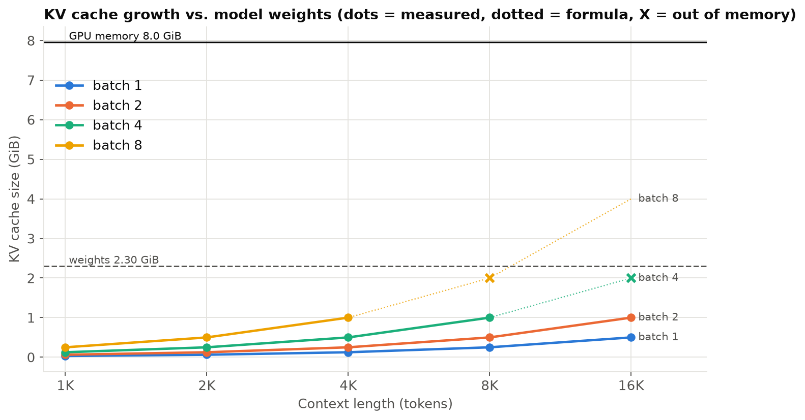
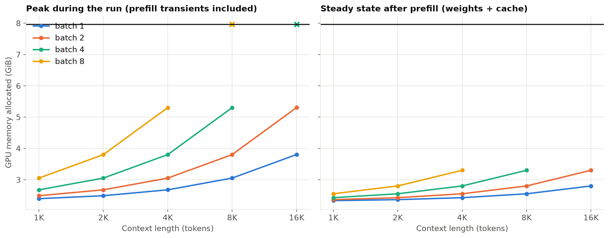
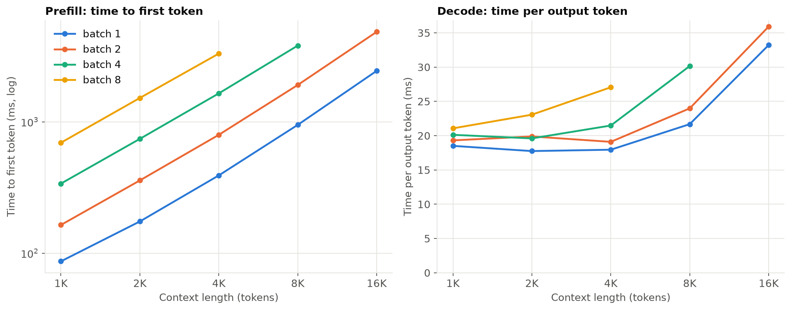
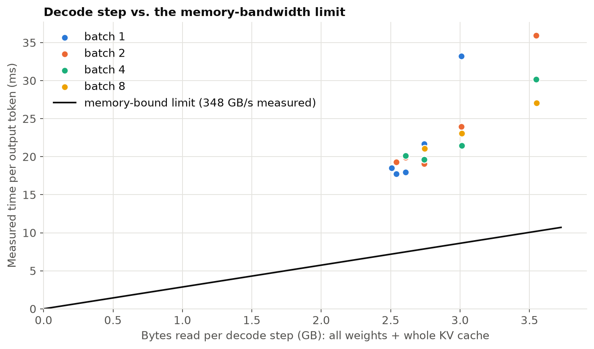
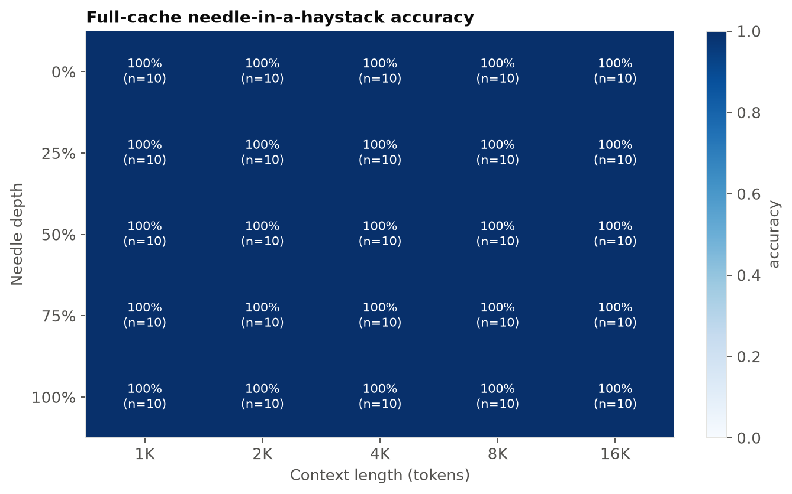
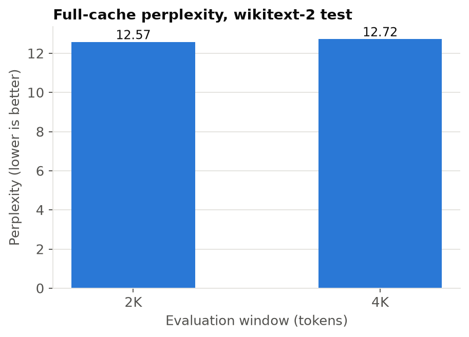

# Baseline: unmodified FP16 full KV cache

*unsloth/Llama-3.2-1B-Instruct on NVIDIA GeForce RTX 5060 Laptop GPU*

## Key numbers
- KV cache formula check: measured cache bytes match 2 x L x H x d x S x B x 2 B within 0.000% over 51 runs (max |error|).
- Weights are 2.30 GiB. The cache is as large as the weights at 75,428 tokens for batch 1 and 9,429 tokens for batch 8; beyond that the cache dominates memory.
- Out of memory first appears at batch 4 x 16K tokens (weights + formula cache = 4.30 GiB; usable cap 7.16 GiB = 90% of 7.96 GiB; weights + cache alone would fit, so the failure comes from prefill transients).
- Batch 1, 4K context: TTFT 391 ms, TPOT 18.0 ms (56 tokens/s).
- Decode-time vs. bytes-read fit is not reported: it was not physically meaningful on this data.
- Achievable GPU memory bandwidth: 348 GB/s (read), 314 GB/s (copy, read+write).
- Full-cache needle accuracy (mean over depths): 1K 100%, 2K 100%, 4K 100%, 8K 100%, 16K 100%; overall 100% over 250 prompts. This is the ceiling every eviction policy is compared to.
- Full-cache perplexity (wikitext-2, chunked 256): 2K window 12.57, 4K window 12.72.

## Setup

| Item | Value |
|---|---|
| GPU | NVIDIA GeForce RTX 5060 Laptop GPU (7.96 GiB VRAM, sm_120) |
| Model | unsloth/Llama-3.2-1B-Instruct (revision 5a8abab4a5) |
| Setup | FP16, SDPA, flash/mem-efficient kernels only (GQA-aware), full KV cache (no eviction) |
| Weights | 2.30 GiB |
| KV cache per token | 32.0 KiB  (16 layers x 8 KV heads x 64 dim x 2 (K,V) x 2 B) |
| Software | torch 2.11.0+cu128, transformers 5.19.0, driver 610.74 |

## Cache bottleneck

| batch | cache = weights at (tokens) | largest context that ran | first out-of-memory | cache at largest run (GiB) |
|---|---|---|---|---|
| 1 | 75,428 | 16K | none up to tested max | 0.50 |
| 2 | 37,714 | 16K | none up to tested max | 1.00 |
| 4 | 18,857 | 8K | 16K | 1.00 |
| 8 | 9,429 | 4K | 8K | 1.00 |

## Latency and the bandwidth limit

| context | TTFT ms (batch 1) | TTFT ms (batch 2) | TTFT ms (batch 4) | TTFT ms (batch 8) | TPOT ms (batch 1) | TPOT ms (batch 2) | TPOT ms (batch 4) | TPOT ms (batch 8) |
|---|---|---|---|---|---|---|---|---|
| 1K | 86.7 | 164.0 | 338.7 | 693.3 | 18.5 | 19.3 | 20.1 | 21.1 |
| 2K | 174.4 | 358.0 | 741.8 | 1519.4 | 17.8 | 19.9 | 19.6 | 23.1 |
| 4K | 390.8 | 796.0 | 1645.6 | 3305.1 | 18.0 | 19.1 | 21.5 | 27.1 |
| 8K | 947.8 | 1906.8 | 3803.3 |  | 21.7 | 24.0 | 30.2 |  |
| 16K | 2442.0 | 4839.8 |  |  | 33.2 | 35.9 |  |  |

## Measured vs. formula (per batch x context)

| batch | context | cache GiB | formula GiB | error % | peak MiB | steady MiB |
|---|---|---|---|---|---|---|
| 1 | 1K | 0.031 | 0.031 | 0.0 | 96.0 | 32.0 |
| 1 | 2K | 0.062 | 0.062 | 0.0 | 193.0 | 64.0 |
| 1 | 4K | 0.125 | 0.125 | 0.0 | 385.0 | 128.0 |
| 1 | 8K | 0.25 | 0.25 | 0.0 | 770.0 | 256.0 |
| 1 | 16K | 0.5 | 0.5 | 0.0 | 1540.0 | 512.0 |
| 2 | 1K | 0.062 | 0.062 | 0.0 | 192.0 | 64.0 |
| 2 | 2K | 0.125 | 0.125 | 0.0 | 385.0 | 128.0 |
| 2 | 4K | 0.25 | 0.25 | 0.0 | 769.0 | 256.0 |
| 2 | 8K | 0.5 | 0.5 | 0.0 | 1538.0 | 512.0 |
| 2 | 16K | 1.0 | 1.0 | 0.0 | 3076.0 | 1024.0 |
| 4 | 1K | 0.125 | 0.125 | 0.0 | 384.0 | 128.0 |
| 4 | 2K | 0.25 | 0.25 | 0.0 | 769.0 | 256.0 |
| 4 | 4K | 0.5 | 0.5 | 0.0 | 1537.0 | 512.0 |
| 4 | 8K | 1.0 | 1.0 | 0.0 | 3074.0 | 1024.0 |
| 8 | 1K | 0.25 | 0.25 | 0.0 | 768.0 | 256.0 |
| 8 | 2K | 0.5 | 0.5 | 0.0 | 1537.0 | 512.0 |
| 8 | 4K | 1.0 | 1.0 | 0.0 | 3073.0 | 1024.0 |

## Quality reference: needle-in-a-haystack (T1 baseline)

## Quality reference: perplexity (T2/T3 baseline)

