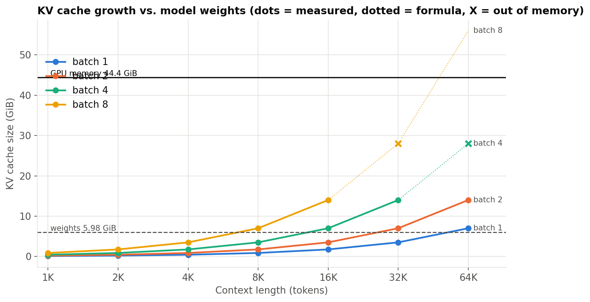
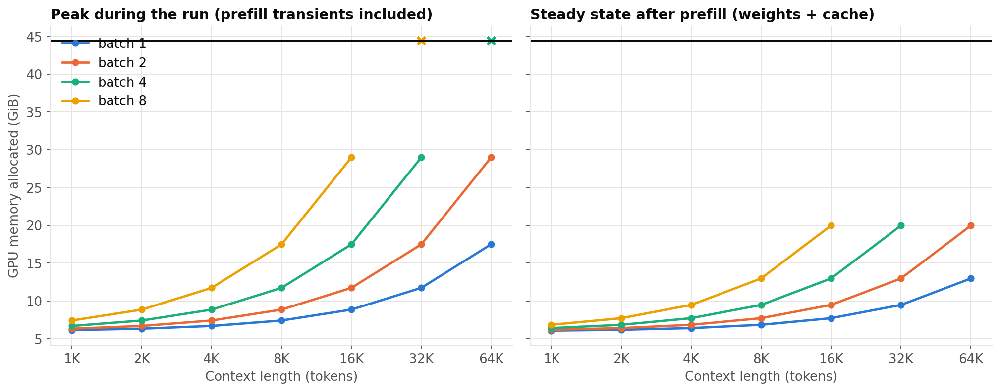
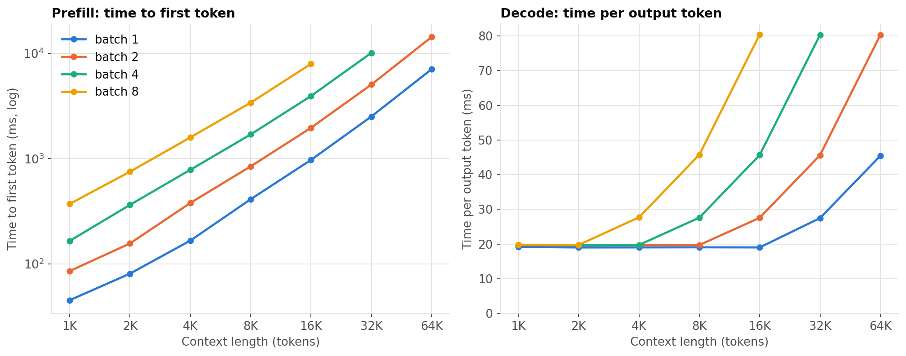
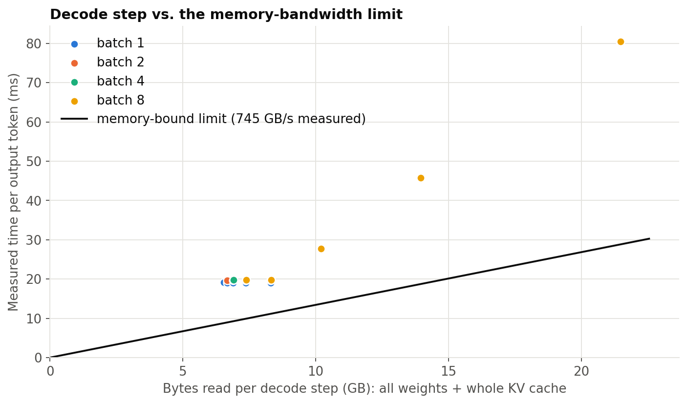
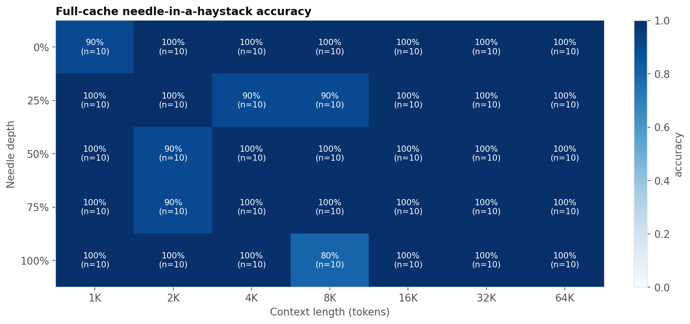
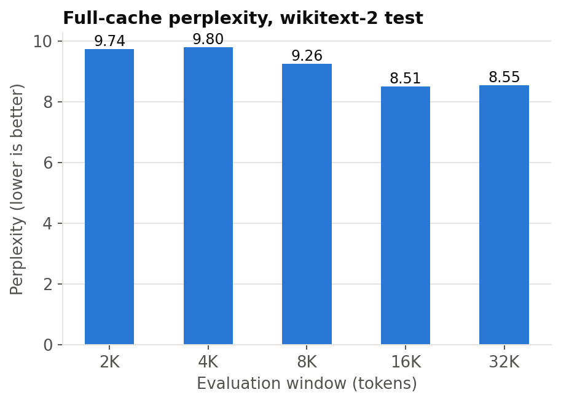

# Baseline: unmodified FP16 full KV cache

*unsloth/Llama-3.2-3B-Instruct on NVIDIA L40S*

## Key numbers
- KV cache formula check: measured cache bytes match 2 x L x H x d x S x B x 2 B within 0.000% over 75 runs (max |error|).
- Weights are 5.98 GiB. The cache is as large as the weights at 56,026 tokens for batch 1 and 7,003 tokens for batch 8; beyond that the cache dominates memory.
- Out of memory first appears at batch 4 x 64K tokens (weights + formula cache = 33.98 GiB; usable cap 39.98 GiB = 90% of 44.42 GiB; weights + cache alone would fit, so the failure comes from prefill transients).
- Batch 1, 4K context: TTFT 166 ms, TPOT 19.0 ms (53 tokens/s).
- Decode-time vs. bytes-read fit is not reported: it was not physically meaningful on this data.
- Achievable GPU memory bandwidth: 745 GB/s (read), 652 GB/s (copy, read+write).
- Full-cache needle accuracy (mean over depths): 1K 98%, 2K 96%, 4K 98%, 8K 94%, 16K 100%, 32K 100%, 64K 100%; overall 98% over 350 prompts. This is the ceiling every eviction policy is compared to.
- Full-cache perplexity (wikitext-2, chunked 256) (windows start with BOS): 2K window 9.74, 4K window 9.80, 8K window 9.26, 16K window 8.51, 32K window 8.55.

## Setup

| Item | Value |
|---|---|
| GPU | NVIDIA L40S (44.42 GiB VRAM, sm_89) |
| Model | unsloth/Llama-3.2-3B-Instruct (revision 006f5dcd13) |
| Setup | FP16, SDPA, flash/mem-efficient kernels only (GQA-aware), full KV cache (no eviction) |
| Weights | 5.98 GiB |
| KV cache per token | 112.0 KiB  (28 layers x 8 KV heads x 128 dim x 2 (K,V) x 2 B) |
| Software | torch 2.11.0+cu128, transformers 5.19.0, driver 610.57.04 |

## Cache bottleneck

| batch | cache = weights at (tokens) | largest context that ran | first out-of-memory | cache at largest run (GiB) |
|---|---|---|---|---|
| 1 | 56,026 | 64K | none up to tested max | 7.00 |
| 2 | 28,013 | 64K | none up to tested max | 14.00 |
| 4 | 14,006 | 32K | 64K | 14.00 |
| 8 | 7,003 | 16K | 32K | 14.00 |

## Latency and the bandwidth limit

| context | TTFT ms (batch 1) | TTFT ms (batch 2) | TTFT ms (batch 4) | TTFT ms (batch 8) | TPOT ms (batch 1) | TPOT ms (batch 2) | TPOT ms (batch 4) | TPOT ms (batch 8) |
|---|---|---|---|---|---|---|---|---|
| 1K | 45.0 | 85.2 | 164.9 | 370.9 | 19.2 | 19.6 | 19.7 | 19.8 |
| 2K | 80.6 | 156.1 | 363.1 | 750.8 | 19.0 | 19.6 | 19.7 | 19.7 |
| 4K | 166.1 | 378.7 | 782.5 | 1589.6 | 19.0 | 19.7 | 19.7 | 27.7 |
| 8K | 410.6 | 842.7 | 1696.3 | 3400.7 | 19.1 | 19.7 | 27.6 | 45.8 |
| 16K | 971.2 | 1961.8 | 3933.0 | 7949.4 | 19.0 | 27.6 | 45.7 | 80.4 |
| 32K | 2511.8 | 5053.9 | 10119.5 |  | 27.5 | 45.6 | 80.3 |  |
| 64K | 7080.3 | 14328.5 |  |  | 45.4 | 80.3 |  |  |

## Measured vs. formula (per batch x context)

| batch | context | cache GiB | formula GiB | error % | peak MiB | steady MiB |
|---|---|---|---|---|---|---|
| 1 | 1K | 0.109 | 0.109 | 0.0 | 185.0 | 112.0 |
| 1 | 2K | 0.219 | 0.219 | 0.0 | 369.0 | 224.0 |
| 1 | 4K | 0.438 | 0.438 | 0.0 | 738.0 | 448.0 |
| 1 | 8K | 0.875 | 0.875 | 0.0 | 1476.0 | 896.0 |
| 1 | 16K | 1.75 | 1.75 | 0.0 | 2952.0 | 1792.0 |
| 1 | 32K | 3.5 | 3.5 | 0.0 | 5904.0 | 3584.0 |
| 1 | 64K | 7.0 | 7.0 | 0.0 | 11808.0 | 7168.0 |
| 2 | 1K | 0.219 | 0.219 | 0.0 | 369.0 | 224.0 |
| 2 | 2K | 0.438 | 0.438 | 0.0 | 737.0 | 448.0 |
| 2 | 4K | 0.875 | 0.875 | 0.0 | 1474.0 | 896.0 |
| 2 | 8K | 1.75 | 1.75 | 0.0 | 2948.0 | 1792.0 |
| 2 | 16K | 3.5 | 3.5 | 0.0 | 5896.0 | 3584.0 |
| 2 | 32K | 7.0 | 7.0 | 0.0 | 11792.0 | 7168.0 |
| 2 | 64K | 14.0 | 14.0 | 0.0 | 23584.0 | 14336.0 |
| 4 | 1K | 0.438 | 0.438 | 0.0 | 737.0 | 448.0 |
| 4 | 2K | 0.875 | 0.875 | 0.0 | 1473.0 | 896.0 |
| 4 | 4K | 1.75 | 1.75 | 0.0 | 2946.0 | 1792.0 |
| 4 | 8K | 3.5 | 3.5 | 0.0 | 5892.0 | 3584.0 |
| 4 | 16K | 7.0 | 7.0 | 0.0 | 11784.0 | 7168.0 |
| 4 | 32K | 14.0 | 14.0 | 0.0 | 23568.0 | 14336.0 |
| 8 | 1K | 0.875 | 0.875 | 0.0 | 1473.0 | 896.0 |
| 8 | 2K | 1.75 | 1.75 | 0.0 | 2945.0 | 1792.0 |
| 8 | 4K | 3.5 | 3.5 | 0.0 | 5890.0 | 3584.0 |
| 8 | 8K | 7.0 | 7.0 | 0.0 | 11780.0 | 7168.0 |
| 8 | 16K | 14.0 | 14.0 | 0.0 | 23560.0 | 14336.0 |

## Quality reference: needle-in-a-haystack (T1 baseline)

## Quality reference: perplexity (T2/T3 baseline)

